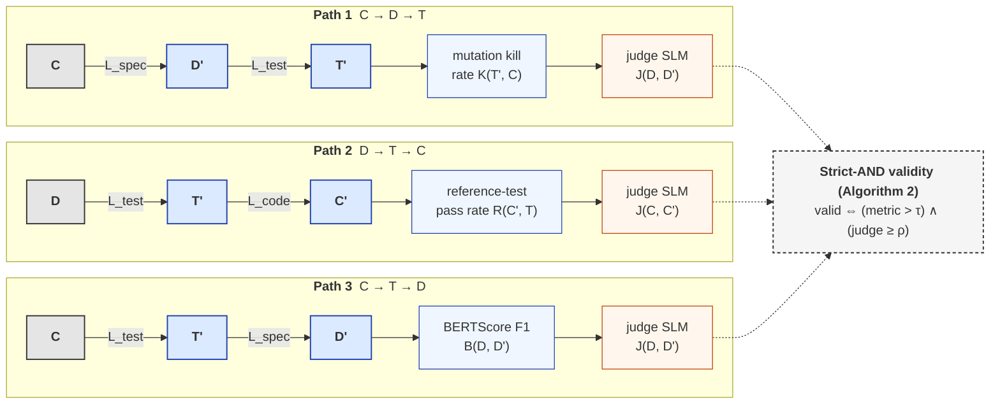

# roundtrip-closure

**Heterogeneous Multi-SLM Closure of the Docstring–Test–Code Triangle: A Cross-Stage Empirical Study**

Replication package for the paper of the same title, currently under major-revision review. All author and institutional identifiers are redacted for double-blind review and will be restored at acceptance.

## What this study measures

For each function `f` in HumanEval + MBPP, we traverse the docstring–test–code triangle via one of three **closure paths**, each composed of two Small Language Model (SLM) stages. A closure is decided by a strict-AND two-signal validity policy combining an SE-validated automated metric with an external judge SLM's semantic-equivalence rating.



Central research question: **when the pipeline is composed of multiple SLMs, does it matter which SLM sits at which stage?**

## Headline results (verifiable from this repo)

- **5,890-row sweep** on 20 pre-registered cells × 3 closure paths × 150 HumanEval + MBPP functions
- **H1 composition** (phi-4 spec + qwen-coder test/code) achieves highest point-estimate kill rate on **4 of 5** mutation operators (Δ up to +0.133)
- **phi-4-in-test-stage pathology**: filter-failing test suites on 44–55% of samples across 3 open-weight cells, replicating across all 4 major provider families (Microsoft, Anthropic, OpenAI, Google) at 44–95%
- **BERTScore / judge disagreement flips direction across benchmarks** (χ² = 368, p < 0.001) — structural signature of a surface-form metric
- **Cell × path interaction** ANOVA: F(36, 4867) = 6.47, p < 0.001

## Open-weight SLM lineup (all <30 B parameters)

| Slot | Ollama tag | Family | Size | Role |
|---|---|---|---|---|
| Small floor | `llama3.2:3b` | Meta | 3 B dense | pipeline |
| Mid-dense reasoning | `phi4:14b` | Microsoft | 14 B dense | pipeline |
| Latest dense general | `qwen3.6:27b` | Alibaba | 27 B dense | pipeline |
| Latest MoE | `gemma4:26b` | Google | 26 B MoE | pipeline |
| Mistral latest | `mistral-small3.2:24b` | Mistral | 24 B dense | pipeline |
| Coder specialist | `qwen3-coder:30b` | Alibaba (coder) | 30 B MoE | pipeline |
| **Judge** | `deepseek-r1:14b` | DeepSeek | 14 B dense | external judge |

Six pipeline SLMs from five distinct families; DeepSeek as the family-disjoint judge. The RQ4 extension (see below) additionally sweeps three closed-weight frontier models (Anthropic Claude Sonnet 5, OpenAI GPT-5.4 Mini, Google Gemini 2.5 Pro) through OpenRouter.

## Reproduce the paper's claims

### Fast path — verify tables and figures from the cached sweep

```bash
pip install -e .

# Regenerate all 24 tables and 5 figures from the released sweep TSV
python3 scripts/run_analysis.py --tsv results/results_roundtrip.tsv
```

Output tables land in `tables/tab_*.tex` and figures in `plots/output/`. All paper numbers are derivable from `results/results_roundtrip.tsv` alone.

### Full sweep — reproduce the TSV from cold

```bash
# 1. Pull models
ollama pull llama3.2:3b phi4:14b qwen3.6:27b gemma4:26b \
            mistral-small3.2:24b qwen3-coder:30b deepseek-r1:14b

# 2. Download datasets + build the HEM-25 subset
python3 prepare_roundtrip.py

# 3. Sanity-check with the 30-function pilot
python3 scripts/run_pilot.py

# 4. Full 20-cell sweep (edit CELL_ID in train_roundtrip.py per cell)
python3 train_roundtrip.py
```

Expected wall-clock: ~530 GPU-hours total (A100), ~8–10 wall-clock weeks on a single-researcher Colab Pro+ subscription. Five-layer checkpointing means interruptions do not re-run completed work.

### Gap-closer scripts (G1–G6)

```bash
python3 scripts/build_threshold_sensitivity.py         # G1
python3 scripts/regen_per_operator.py && \
  python3 scripts/build_per_operator_table.py          # G2
python3 scripts/build_disagreement_decomposition.py    # G3
python3 scripts/build_capability_preservation.py       # G4
python3 scripts/build_path_cell_anova.py               # G5
python3 scripts/build_stage_contribution_figure.py     # G6
```

### Unit tests (67 total)

```bash
pytest tests/   # 51 decision-and-filter + 16 wiring-integration
```

## Project layout

```
roundtrip-closure/
├── LICENSE                  ← MIT license (replication-package release)
├── README.md                ← this file
├── pyproject.toml           ← deps + project metadata
├── concept_note.md          ← pre-registered design doc (committed 4 weeks before first sweep)
│
├── Core pipeline (Python functions with unit tests)
├── config.py                ← model lineup + per-cell config
├── doe.py                   ← 20-cell pre-registered DOE table
├── train_roundtrip.py       ← main experiment driver
├── prepare_roundtrip.py     ← dataset preparation
├── closure_paths.py         ← Path 1/2/3 traversal drivers
├── closure_decision.py      ← strict-AND validity algorithm (Algorithm 2)
├── closure_metrics.py       ← kill rate / pass rate / BERTScore (BERTScore cached)
├── mutation_testing.py      ← five canonical operators
├── judge_llm.py             ← DeepSeek-R1 equivalence judge (0–4 rubric)
├── decontaminate.py         ← HEM-25 transformation (function-rename + docstring-paraphrase + parameter-permutation)
├── ollama_client.py         ← Ollama wrapper with retry + rate limiting
├── openrouter_client.py     ← closed-weight routing (Sonnet 5 / GPT-5.4 Mini / Gemini 2.5 Pro)
├── closure_cache.py         ← SHA-256 keyed disk cache
├── pytest_cache.py          ← SHA-256 keyed pytest subprocess cache
│
├── scripts/                 ← build and analysis pipeline
│   ├── run_analysis.py      ← single-command regeneration of all 24 tables + 5 figures
│   ├── run_pilot.py         ← 30-function pilot driver
│   ├── build_*.py           ← G1–G6 gap-closer scripts
│   ├── regen_per_operator.py
│   └── verify_duplicate_groups.py
│
├── analyze/                 ← statistical and table modules
│   ├── stats.py             ← ANOVA, Tukey, mixed-logit, judge-metric correlation
│   ├── tables.py            ← LaTeX table emitters for all 24 tables
│   ├── holdout_sensitivity.py ← HEM-25 transformation-robustness analysis
│   └── load_results.py      ← TSV loader + validity filter
│
├── tests/                   ← 67 unit tests
│   ├── test_closure_decision.py    ← 43 tests (20 def × @parametrize)
│   ├── test_filter_tests_reason.py ← 8 tests
│   ├── test_wiring_integration.py  ← 16 tests
│   └── test_smoke.py               ← 4 end-to-end smoke tests
│
├── tables/                  ← 24 generated LaTeX tables (regenerable via run_analysis.py)
│
├── human_eval/              ← 60-pair five-annotator study + frontier-judge replay
│   └── data/
│       ├── annotator_A[123]_ratings.tsv          ← author-team annotators
│       ├── annotator_A[123]_uniform_ratings.tsv  ← confirmatory uniform-draw
│       ├── annotator_E[12]_ratings.tsv           ← external annotators
│       └── frontier_judge_*.tsv                  ← GPT-4o-mini + Claude Haiku 4.5 + Llama-3.3-70B replay
│
├── references.bib           ← bibliography (referenced from paper)
│
├── results/                 ← sweep outputs (TSV + JSON summaries)
│   └── results_roundtrip.tsv   ← 5,890-row sweep
│
├── data/                    ← datasets (gitignored; rebuilt by prepare_roundtrip.py)
├── checkpoints/             ← LLM-call cache + intermediate artifacts (gitignored)
└── logs/                    ← per-cell run logs (gitignored)
```

## Five-layer checkpointing (nothing is recomputed twice)

| Layer | What it caches | Storage | Survives disconnect |
|---|---|---|---|
| 1 | Every LLM call (model × role × prompt × params) | `checkpoints/cache/` | ✓ via Drive symlink |
| 2 | Every pytest subprocess (test × code × timeout) | `checkpoints/pytest_cache/` | ✓ |
| 3 | BERTScore F1 per docstring pair | `checkpoints/cache/` (judge-role key) | ✓ |
| 4 | Row-level resume per `(cell, sample, path)` tuple | `results/results_roundtrip.tsv` | ✓ |
| 5 | Decontamination per-problem JSONL append | `data/humaneval_mutated_50.jsonl` | ✓ |

All writes use atomic `.tmp → os.replace` with explicit `flush + fsync` to defend against Colab Drive FUSE write-back lag.

## Human evaluation

The 60-pair human-evaluation study was conducted with five annotators under the paper's pre-registered rubric. All per-annotator rating files are released here under the paper's double-blind anonymization scheme:

- `annotator_A1-A3_ratings.tsv` — author-team annotators (3 of 5)
- `annotator_E1-E2_ratings.tsv` — external annotators (2 of 5)
- `annotator_A1-A3_uniform_ratings.tsv` — confirmatory uniform-draw study (author team only; see §5.8)
- `frontier_judge_*.tsv` — three frontier judges (GPT-4o-mini, Claude Haiku 4.5, Llama-3.3-70B-Instruct) rating the same 60 pairs, backing Table 9

## Data availability + pre-registration

- **Pre-registration**: `concept_note.md` was committed to the repository approximately four weeks before the first sweep row was recorded (verifiable via `git log --follow concept_note.md`); the 20-cell DOE and all cell hypotheses were fixed at that point.
- **Sweep TSV**: `results/results_roundtrip.tsv` — 5,890 rows × 24 columns covering 20 DOE cells, 3 closure paths, 150 functions.
- **Human-eval TSVs**: `human_eval/data/` as listed above.
- **Replication claim**: every table and figure in the paper regenerates from the sweep TSV via `scripts/run_analysis.py`.

## License

[MIT](LICENSE) — replication package released for double-blind review and subsequent public use. Real author and institutional information will be restored at camera-ready.
